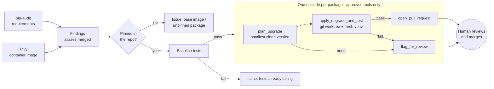

# Vulnerability Remediation Agent

An AI agent that finds vulnerable dependencies in a Python repository and proposes fixes, while a human keeps the final say.

It scans the code (pip-audit) and the container image (Trivy), looks up each vulnerability, picks the **smallest safe version upgrade**, and explains the change in plain language. It opens a pull request **only if the tests still pass** after the fix; otherwise it opens an issue for a person to handle. It can only use a short list of approved tools, and **it never merges anything**.

**Stack:** Python · Azure OpenAI (tool calling) · GitHub Actions · Docker · Trivy · pip-audit

## Results

Run on the three test repositories in [`eval/fixtures/`](eval/fixtures) (19 Oct 2026, live PyPI advisory data):

| Repository | Vulnerabilities | Fixed (PR, tests pass) | Escalated |
|---|---|---|---|
| auth-service | 18 | 6 | 12 |
| report-renderer | 19 | 15 | 4 |
| web-app | 30 | 18 | 12 |
| **Total** | **67** | **39** | **28** |

**Fixed 39 of 67 known vulnerabilities automatically (11 pull requests), with 28 escalated for review:** 25 because the smallest safe upgrade broke the tests, 2 because it conflicted with another pinned dependency, and 1 because no fixed release exists.

The escalations are the interesting part, and each is a real-world pattern:

- **PyJWT 1.7.1 → 2.15.0** breaks `jwt.encode(...).decode()` (2.x returns `str`, not `bytes`).
- **Jinja2 2.11 → 3.1.6** removes `jinja2.Markup`, which the renderer imports.
- **Werkzeug 2.2 → 3.1** removes `werkzeug.urls.url_quote`, which Flask 2.2 needs; **Flask 2.2 → 3.1** needs a newer Werkzeug than the one pinned. The two must be upgraded together, so a person decides.
- **ecdsa**: one CVE (Minerva timing attack) has no fix at all; the other is fixed by 0.19.2, so the agent opens the PR *and* an issue for the leftover.

Vulnerabilities are counted once per package after merging aliases (the same issue often appears as `PYSEC-…`, `GHSA-…` and `CVE-…`). The full would-be pull requests, issues and audit logs are in [`eval/results/`](eval/results). The CI job re-runs this on every push, so numbers will drift as new advisories are published.

## How it works



1. **Scan.** pip-audit reads the pinned requirements file; Trivy scans the image built from the project's Dockerfile. Python packages found in the image are matched to the requirements file; OS packages and unpinned packages are escalated, because a dependency bump can't fix them.
2. **Baseline.** The tests run once on the untouched code. If they already fail, the agent changes nothing and says so.
3. **Plan.** For each package, code (not the model) finds the smallest released version that leaves no *fixable* vulnerability. "Fixed in" data only narrows the search; each candidate is confirmed against PyPI's vulnerability list for that exact version, which also catches issues *introduced* in newer releases and skips versions that don't support the project's Python.
4. **Test.** The upgrade is applied in a separate git worktree, installed into a fresh virtualenv and tested. The operator's checkout is never modified.
5. **Decide.** Tests pass → pull request on a `vra/<package>-<version>` branch. Anything else → issue with the reason, the smallest safe version, and the failing test output.
6. **Explain.** With Azure OpenAI configured, the model drives the episode through the tools and writes the explanation. Without it, a rule-based policy runs the same tools in the same order with templated text. Facts in the PR (versions, advisories, test result) are always generated by code, so the model can add context but can't misstate them.

## Guardrails

These are enforced in code and covered by [`tests/test_guardrails.py`](tests/test_guardrails.py), including a scripted model that tries to misbehave.

| Rule | How it's enforced |
|---|---|
| Only approved tools | The model is offered exactly five tools (`APPROVED_TOOLS` in [`tools.py`](src/remediation_agent/tools.py)). Any other name is refused and logged. |
| Model can't pick a version | No tool accepts a version argument; `apply_upgrade_and_test` uses the version from `plan_upgrade`. |
| PR only if tests pass | `open_pull_request` refuses unless tests passed for exactly the planned version. |
| Honest escalations | `flag_for_review` refuses a reason that doesn't match the tool results (e.g. "tests failed" when they passed). |
| Never merges | No merge tool exists. The GitHub client has no merge/approve method and refuses `/merge`, `auto_merge`, `/reviews`, `DELETE`, and writes to `main`/`master`. Pushes go only to `vra/*` branches. |
| No shell | Subprocesses go through an allowlist (`git`, `pip-audit`, `trivy`, `python`, the configured test command) with no shell. |
| Fail safe | If the model errors, times out or ends without deciding, the package is escalated, never fixed. |
| Audit trail | Every tool call, refusal and command is written to `audit.jsonl`. |

For production, also protect the default branch (required review) so the "never merges" rule holds for any token.

## Usage

```bash
pip install .

# Dry run: write the would-be PRs and issues to ./vra-output
vra --repo path/to/project --dry-run

# Real run: open PRs and issues on GitHub
GITHUB_TOKEN=... vra --repo . --github-repo owner/name

# Monorepo, custom tests, container image
vra --repo . --project-dir services/api --test-command "python -m pytest -q tests/unit" \
    --image myapp:latest --dry-run
```

To let the model drive the episodes, set `AZURE_OPENAI_ENDPOINT`, `AZURE_OPENAI_API_KEY` and `AZURE_OPENAI_DEPLOYMENT` (optionally `AZURE_OPENAI_API_VERSION`). Model transcripts are saved under `vra-output/transcripts/`.

Re-run the evaluation with `python eval/run_eval.py` (add `--model` to use Azure OpenAI).

### GitHub Actions

- [`ci.yml`](.github/workflows/ci.yml): lint, tests on Python 3.11–3.13, the evaluation, and the Docker image build.
- [`remediate.yml`](.github/workflows/remediate.yml): runs the agent (manually or on a schedule), including building and scanning the project's image with Trivy. It defaults to a dry run on `eval/fixtures/auth-service`; untick *dry run* to open real PRs and issues. Add the Azure values as repository secrets to enable the model. For `GITHUB_TOKEN` to open PRs, enable *Settings → Actions → General → Allow GitHub Actions to create and approve pull requests*. PRs opened with `GITHUB_TOKEN` don't trigger other workflows; use a GitHub App token if CI must run on them.

Trivy is installed as the pinned v0.69.3 binary with a verified checksum. v0.69.4 and most `aquasecurity/trivy-action` tags were compromised in March 2026 (CVE-2026-33634), so this project doesn't use the action. All other actions are pinned to commit SHAs.

## Limitations

- Python only, and only `name==version` pins in a requirements file. Hash-pinned lock files are escalated to the project's lock tooling rather than edited.
- Each package is tested on its own. Two PRs that each pass could still conflict when both are merged; coupled upgrades (like Flask + Werkzeug) are escalated rather than combined.
- The tests are the safety net: a fix is only as safe as the test suite is thorough. Major upgrades are flagged as such in the PR.
- Advisory data comes from PyPI (the PyPA/OSV database). Severity scores come from Trivy when an image is scanned.

## Layout

```
src/remediation_agent/
  agent.py        run orchestration and reporting
  tools.py        the approved tools and the registry that enforces them
  llm.py          Azure OpenAI tool-calling loop and the rule-based policy
  versions.py     smallest-safe-version planner
  scanners.py     pip-audit and Trivy
  workspace.py    git worktrees, virtualenvs, test runs
  github.py       PR/issue client with no merge capability
  sandbox.py      subprocess allowlist and audit log
eval/             test repositories, evaluation runner, results
tests/            unit, guardrail and end-to-end tests
```
